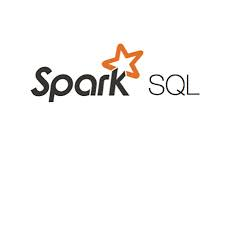

$ spark-sql -e "SELECT city, SUM(amount) FROM lake.orders GROUP BY city"

# Spark SQL

**Spark SQL** is the module of Apache Spark that runs SQL queries and **DataFrame** code on a cluster. Whether you write `spark.sql("SELECT ...")` or `df.groupBy("city").sum("amount")` in Python, Scala, Java or R, both become the same logical plan, are optimized by the **Catalyst** optimizer, and execute as distributed tasks. Today it is the main way people use Spark, and the default batch engine for lakehouse ETL on Parquet, Iceberg and Delta Lake tables.

## From query to tasks


<svg class="lx-svg lx-canvas" viewBox="0 0 760 300">
  <g>
    <rect x="20" y="30" width="160" height="76" rx="6" fill="#fff" stroke="#3D3A49" stroke-width="1.4"/>
    <text x="36" y="54" class="m" font-size="12" font-weight="700" fill="#17151F">QUERY</text>
    <text x="36" y="76" font-size="11" fill="#5C5869">SQL string or</text><text x="36" y="92" font-size="11" fill="#5C5869">DataFrame calls</text>
  </g>
  <g class="f" data-step="1">
    <line x1="180" y1="68" x2="203" y2="68" stroke="#531A8A" stroke-width="2"/><circle cx="203" cy="68" r="3" fill="#531A8A"/>
    <rect x="205" y="30" width="160" height="76" rx="6" fill="#fff" stroke="#3D3A49" stroke-width="1.4"/>
    <text x="221" y="54" class="m" font-size="12" font-weight="700" fill="#17151F">UNRESOLVED</text>
    <text x="221" y="76" font-size="11" fill="#5C5869">parsed tree,</text><text x="221" y="92" font-size="11" fill="#5C5869">names not checked</text>
  </g>
  <g class="f" data-step="2">
    <line x1="365" y1="68" x2="388" y2="68" stroke="#531A8A" stroke-width="2"/><circle cx="388" cy="68" r="3" fill="#531A8A"/>
    <rect x="390" y="30" width="160" height="76" rx="6" fill="#fff" stroke="#3D3A49" stroke-width="1.4"/>
    <text x="406" y="54" class="m" font-size="12" font-weight="700" fill="#17151F">ANALYZED</text>
    <text x="406" y="76" font-size="11" fill="#5C5869">catalog resolves</text><text x="406" y="92" font-size="11" fill="#5C5869">tables and types</text>
  </g>
  <g class="f" data-step="3">
    <line x1="550" y1="68" x2="573" y2="68" stroke="#531A8A" stroke-width="2"/><circle cx="573" cy="68" r="3" fill="#531A8A"/>
    <rect x="575" y="30" width="165" height="76" rx="6" fill="#F4EEFA" stroke="#531A8A" stroke-width="1.4"/>
    <text x="591" y="54" class="m" font-size="12" font-weight="700" fill="#17151F">OPTIMIZED</text>
    <text x="591" y="76" font-size="11" fill="#5C5869">filter pushed to scan,</text><text x="591" y="92" font-size="11" fill="#5C5869">unused columns pruned</text>
  </g>
  <g class="f" data-step="4">
    <line x1="657" y1="106" x2="657" y2="168" stroke="#531A8A" stroke-width="2"/><circle cx="657" cy="168" r="3" fill="#531A8A"/>
    <rect x="575" y="170" width="165" height="76" rx="6" fill="#fff" stroke="#3D3A49" stroke-width="1.4"/>
    <text x="591" y="194" class="m" font-size="12" font-weight="700" fill="#17151F">PHYSICAL PLAN</text>
    <text x="591" y="216" font-size="11" fill="#5C5869">broadcast or</text><text x="591" y="232" font-size="11" fill="#5C5869">sort-merge join?</text>
    <line x1="575" y1="208" x2="552" y2="208" stroke="#531A8A" stroke-width="2"/><circle cx="552" cy="208" r="3" fill="#531A8A"/>
    <rect x="390" y="170" width="160" height="76" rx="6" fill="#fff" stroke="#3D3A49" stroke-width="1.4"/>
    <text x="406" y="194" class="m" font-size="12" font-weight="700" fill="#17151F">CODEGEN</text>
    <text x="406" y="216" font-size="11" fill="#5C5869">whole-stage code,</text><text x="406" y="232" font-size="11" fill="#5C5869">one function per stage</text>
  </g>
  <g class="f" data-step="5">
    <line x1="390" y1="208" x2="367" y2="208" stroke="#531A8A" stroke-width="2"/><circle cx="367" cy="208" r="3" fill="#531A8A"/>
    <rect x="20" y="170" width="345" height="76" rx="6" fill="#260246"/>
    <text x="36" y="194" class="m" font-size="12" font-weight="700" fill="#EEEAF5">EXECUTION</text>
    <text x="36" y="216" font-size="11" fill="#DCC9EE">stages split at shuffles, tasks run on executors,</text><text x="36" y="232" font-size="11" fill="#DCC9EE">failed tasks are retried</text>
    <path d="M190 246 V272 H657 V248" stroke="#531A8A" stroke-width="1.4" stroke-dasharray="4 4" fill="none"/>
    <text x="424" y="290" text-anchor="middle" class="m" font-size="11" fill="#531A8A">AQE: re-plan remaining stages with real sizes</text>
  </g>
</svg>
<ol class="lx-caps">
  <li>SQL text and DataFrame calls enter the <b>same</b> pipeline. There is no performance difference between them.</li>
  <li>The parser builds an <b>unresolved logical plan</b>: a tree of operators whose table and column names are not yet checked.</li>
  <li>The <b>analyzer</b> looks names up in the <b>catalog</b> (Hive Metastore, Unity, Glue, an Iceberg catalog) and fills in types. Typos fail here.</li>
  <li>The <b>optimizer</b> applies rules: push filters into the Parquet scan, prune unused columns, fold constants, and (with the cost-based optimizer and table statistics enabled) reorder joins.</li>
  <li>The <b>physical planner</b> picks operators, such as a <b>broadcast hash join</b> when one side is small. <b>Whole-stage codegen</b> fuses each stage into tight generated code.</li>
  <li>Stages run on executors, separated by <b>shuffles</b>. <b>Adaptive Query Execution</b> uses the real sizes seen at each shuffle to merge small partitions, switch to broadcast joins and split skewed ones.</li>
</ol>


Run `EXPLAIN FORMATTED <query>` or `df.explain("formatted")` to see these plans for your own queries, and the **SQL tab** of the Spark UI to see the executed plan with row counts.

## Key features

- **DataFrames everywhere.** A DataFrame is a distributed table with a schema. **Datasets** add compile-time types but exist only in Scala and Java.
- **Data sources.** Parquet, ORC, JSON, CSV, Avro, JDBC, Kafka, plus table formats (Iceberg, Delta Lake, Hudi) through catalog plugins.
- **Hive compatibility.** Spark can use the Hive Metastore as its catalog, read Hive tables and run most HiveQL. The **Spark Thrift Server** exposes Spark SQL over JDBC.
- **Structured Streaming** uses the same DataFrame API and optimizer for streaming queries.
- **Spark Connect** (since 3.4) separates the client from the cluster over gRPC, so thin Python or Go clients can submit DataFrame plans remotely.
- **Spark 4.0** (2025) turned on **ANSI SQL mode** by default (errors on overflow and invalid casts instead of silent nulls), added the `VARIANT` type for semi-structured data, SQL pipe syntax and SQL user-defined functions, and removed Mesos support.

## Spark SQL vs Trino

| | Spark SQL | Trino / Presto |
|---|---|---|
| Built for | Large batch ETL, mixed SQL + code, ML pipelines | Interactive queries, federation across sources |
| Execution | Stages write shuffle files; failed tasks retry | Pipelined in memory; whole query restarts unless fault-tolerant mode is on |
| Startup latency | Seconds to start a job (less on a warm cluster) | Sub-second on an always-on cluster |
| Languages | SQL, Python, Scala, Java, R | SQL only |

Many platforms use both: Spark writes the tables, Trino serves the dashboards.

## Performance tips

- **Keep AQE on** (default since Spark 3.2) and check skew handling before hand-tuning `spark.sql.shuffle.partitions`.
- **Prefer built-in functions to Python UDFs.** A Python UDF is a black box to Catalyst and moves data between the JVM and Python. If you need one, use pandas/Arrow UDFs.
- **Filter on partition columns and keep files 100 MB to 1 GB.**
- **Cache only what you reuse,** and unpersist it afterwards.
- Native execution engines (Databricks **Photon**, Apache **Gluten** with Velox, Apache DataFusion **Comet**) replace Spark's JVM operators with vectorized C++ or Rust for large speedups on scans and aggregations.

## Common mistakes

- `collect()` or `toPandas()` on a large DataFrame, pulling everything to the driver until it runs out of memory.
- Joining on columns with different types (`string` vs `bigint`), which forces casts and can break pushdown.
- Running `count()` just to log progress; each one is a full job.

## Learning Resources

- [Spark SQL, DataFrames and Datasets Guide](https://spark.apache.org/docs/latest/sql-programming-guide.html): official docs
- [Spark SQL performance tuning](https://spark.apache.org/docs/latest/sql-performance-tuning.html): AQE, joins, caching
- [Spark SQL: Relational Data Processing in Spark](https://people.csail.mit.edu/matei/papers/2015/sigmod_spark_sql.pdf) (SIGMOD 2015): the Catalyst paper
- *Learning Spark* (2nd ed.), Jules Damji et al.: chapters 4 to 7 on Spark SQL and DataFrames
- *Spark: The Definitive Guide*, Bill Chambers and Matei Zaharia
- [A Deep Dive into Query Execution Engine of Spark SQL](https://www.youtube.com/watch?v=ywPuZ_WrHT0): Maryann Xue, video
